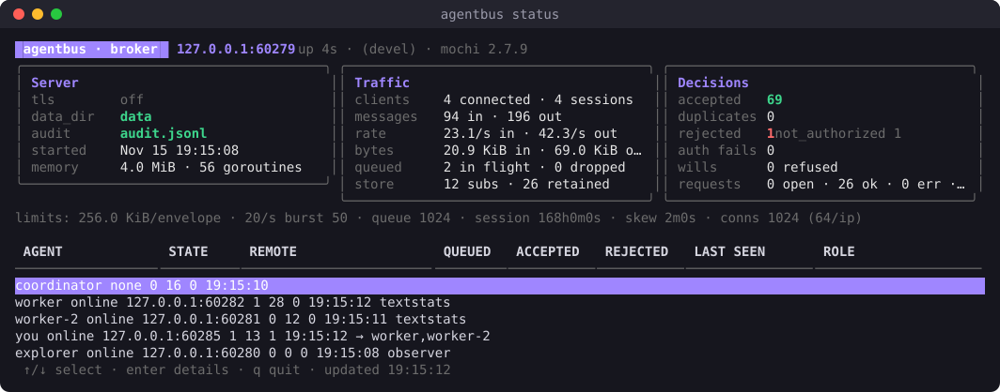
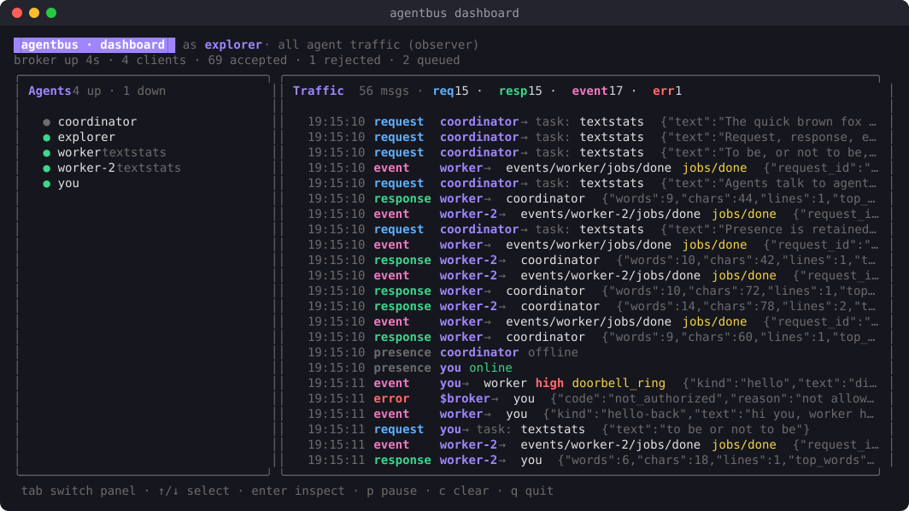
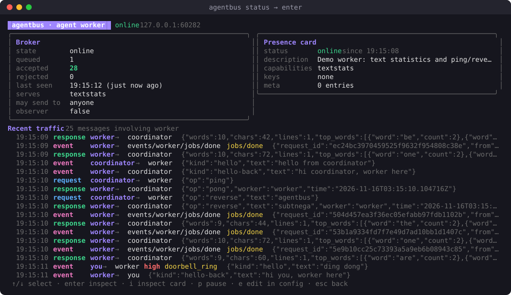
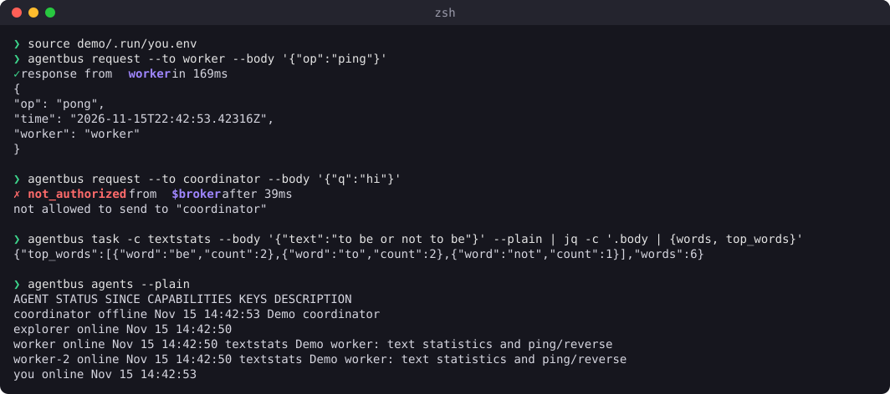

# agentbus demo

Two Go agents talk over a running agentbus broker:

- **worker** ([cmd/worker](cmd/worker/main.go)) serves the `textstats`
  capability from the shared task queue. Its inbox answers `ping` and
  `reverse` requests and replies to `hello` notes. It emits a `jobs/done`
  event after every task.
- **coordinator** ([cmd/coordinator](cmd/coordinator/main.go)) runs a
  scripted conversation with the worker. It checks every reply against a
  local computation and exits non-zero if any step fails.

Both are thin wrappers around [agents/](agents/), which uses the public
[`client`](../client/) package the same way conduit would.

## Run it

```bash
make demo        # or: scripts/demo.sh
```

The script:
1. Builds `bin/agentbus`, `bin/worker` and `bin/coordinator`.
2. Mints a token per agent and writes `demo/.run/broker.json` and one
   `demo/.run/<agent>.env` per agent.
3. Starts the broker on `127.0.0.1:18830` and the worker.
4. Runs the coordinator.

Expected output:

```text
coordinator "coordinator" connected; talking to "worker"

  [ok  ] presence  worker online, capabilities [textstats] (0ms)
  [ok  ] hello     sent hello, got back "hi coordinator, worker here" (0ms)
  [ok  ] ping      pong from worker (0ms)
  [ok  ] reverse   "agentbus" -> "subtnega" (0ms)
  [ok  ] tasks     5 tasks answered and verified, 5 jobs/done events, handled by map[worker:5] (304ms)
  [ok  ] acl       broker refused: broker refused subscription to "$share/textstats/..." (code 0x80) (0ms)

PASS: 6/6 steps
```

| Step | What crosses the bus |
|---|---|
| presence | The coordinator reads the worker's retained presence card. |
| hello | A one-way event to the worker's inbox. The worker sends a one-way event back to the coordinator's inbox. |
| ping, reverse | Request/response through the worker's inbox. |
| tasks | 5 concurrent requests through the shared `textstats` queue. Each answer is verified, and the coordinator waits for one `jobs/done` broadcast per task. |
| acl | The coordinator tries to consume `textstats`. The broker refuses, because only the workers are granted it. |

After the run, the broker and worker stay up until you press Ctrl-C.
`make demo-once` (`scripts/demo.sh --once`) exits right after the
conversation, with the coordinator's exit status.

## Kick the tires

Look inside the running broker. The demo's `explorer` identity is an
observer, which the broker status needs:

```bash
source demo/.run/explorer.env
bin/agentbus status       # live broker view; q to quit
bin/agentbus dashboard    # agents and traffic side by side
```





Run the coordinator again in another terminal and watch the traffic and
counters move.

Every view drills down. In `status`, select an agent and press Enter for
its detail and recent traffic, then Enter on a message to inspect it. In
`dashboard`, Enter on an agent filters the traffic to it. Press `e` to edit
the selected agent in the config editor:



Manage the demo's agents and settings. The demo's env files point the CLI
at the demo's config, so changes apply to the running bus:

```bash
bin/agentbus config        # a add · enter edit · c client setup · r rotate token · d remove
```

Try this:
1. Remove the `textstats` capability from `worker-2`. Within a second it
   stops getting tasks.
2. Rotate `you`'s token. Its connection drops, and `demo/.run/you.env` keeps
   working because the env file points at the token file.

[docs/CLI.md](../docs/CLI.md) covers every command.

In a second terminal, from the repo root, while `make demo` is running:

```bash
source demo/.run/you.env     # act as agent "you"
bin/agentbus agents
```

```text
AGENT        STATUS   SINCE                CAPABILITIES  DESCRIPTION
coordinator  offline  2026-11-15 10:38:35                Demo coordinator
worker       online   2026-11-15 10:38:34  textstats     Demo worker: text statistics and ping/reverse
you          online   2026-11-15 10:38:36
```



Talk to the worker directly:

```bash
bin/agentbus request --to worker --body '{"op":"ping"}'
bin/agentbus request --to worker --body '{"op":"reverse","text":"hello bus"}'
```

Send work through the queue (any worker with the capability takes it):

```bash
bin/agentbus task --capability textstats --body '{"text":"to be or not to be"}'
```

See the broker enforce the rules. `you` may only message the workers:

```bash
bin/agentbus request --to coordinator --body '{}'
# agentbus: $broker: not authorized: not allowed to send to "coordinator"
```

Watch broadcasts live:

```bash
bin/agentbus watch           # prints jobs/done events as JSON lines
```

See load balancing by starting a second worker (it has its own identity and
the same capability) and rerunning the coordinator:

```bash
(source demo/.run/worker-2.env && bin/worker -delay 300ms)
```

```bash
(source demo/.run/coordinator.env && bin/coordinator > /dev/null)
#  [ok  ] tasks  5 tasks answered and verified, ... handled by map[worker:4 worker-2:1]
```

Each process needs its own identity. Start `worker-2` only once: a second
copy with the same ID knocks the first off the bus, and they keep taking
turns. `demo/.run/broker.log` then shows `agent session taken over`.

Stop a worker with Ctrl-C and run `bin/agentbus agents` again. The broker
has marked it offline and kept its card.

Write a worker in shell. `handle -exec` runs a command per message, with
the envelope on stdin and the reply body on stdout:

```bash
source demo/.run/worker-2.env
bin/agentbus handle --capability textstats \
  -exec 'jq -c "{words: (.body.text | split(\" \") | length), worker: \"shell\"}"'
```

Watch the bus in a desktop app. The demo creates a read-only observer
called `explorer`; its token (the password) is in `demo/.run/tokens/explorer.token`. In
MQTT Explorer, connect to `127.0.0.1:18830` with username **and client ID**
`explorer` and the token as the password. The full guide, including MQTTX
and `mosquitto_sub`, is [docs/DESKTOP-CLIENTS.md](../docs/DESKTOP-CLIENTS.md).

See retention work. The demo's worker keeps a persistent session, so a task
sent while it's down waits for it instead of failing. Stop the worker the
demo started:

```bash
pkill -f 'bin/worker -delay'
```

Send a task. It blocks, waiting:

```bash
bin/agentbus task --capability textstats --body '{"text":"queued while you were out"}' --timeout 60s
```

In another terminal, start the worker again. The waiting task is answered
right away:

```bash
(source demo/.run/worker.env && bin/worker -delay 300ms)
```

The audit trail shows each decision:

```bash
jq -c '{ts, action, from, to, type, code}' demo/.run/audit.jsonl
```

Read the broker's log:

```bash
tail -f demo/.run/broker.log
```

## Files the demo writes

```text
demo/.run/            gitignored; recreated on every run
├── broker.json       broker config with token hashes
├── tokens/<agent>.token  each agent's token (0600)
├── <agent>.env       AGENTBUS_URL / AGENTBUS_CONFIG / AGENTBUS_AGENT / AGENTBUS_TOKEN_FILE per agent
│                     (coordinator, worker, worker-2, you, explorer)
├── broker.log        broker log
├── audit.jsonl       audit trail: one JSON line per decision, no bodies
├── data/             retained broker state (bbolt), wiped each run
├── worker.log        worker log
└── summary.json      coordinator's JSON result
```

Each run mints new tokens, so `.env` files from an earlier run stop
working once the demo restarts.
