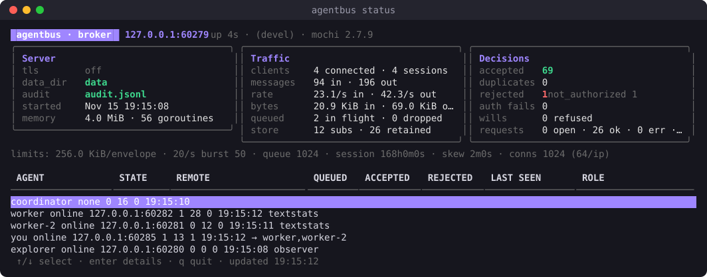
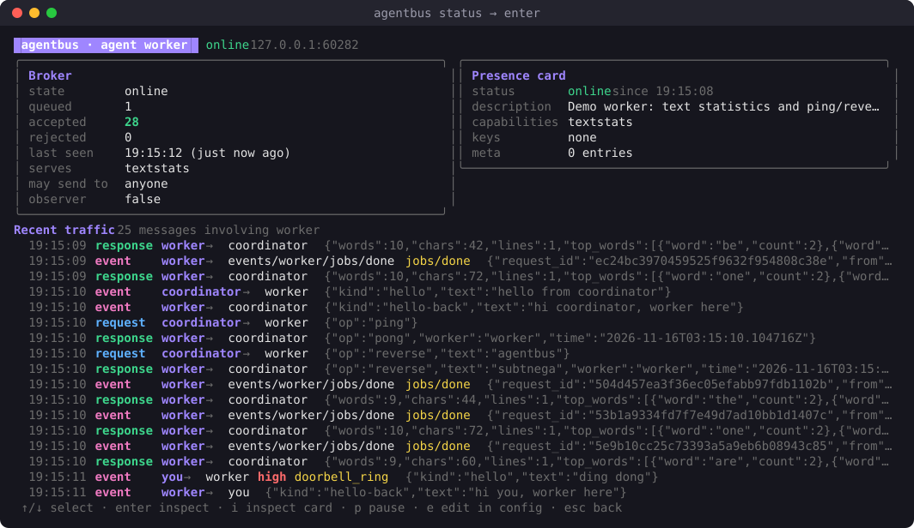
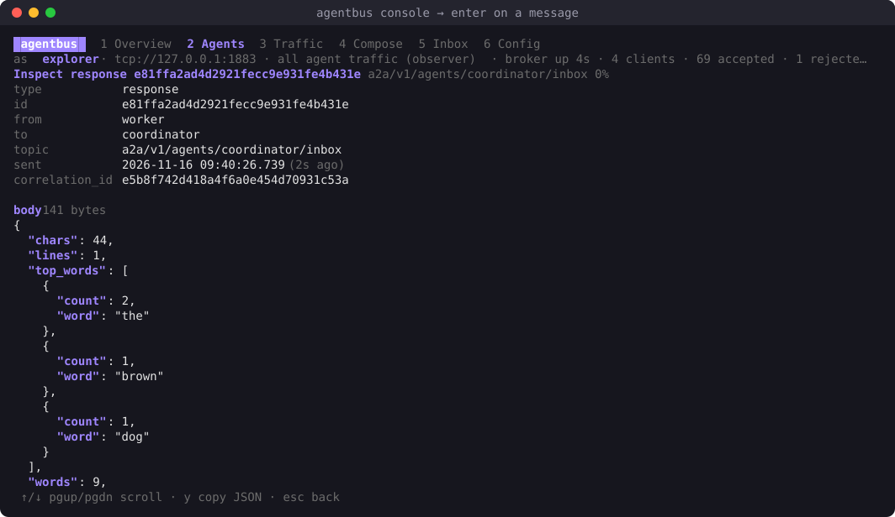
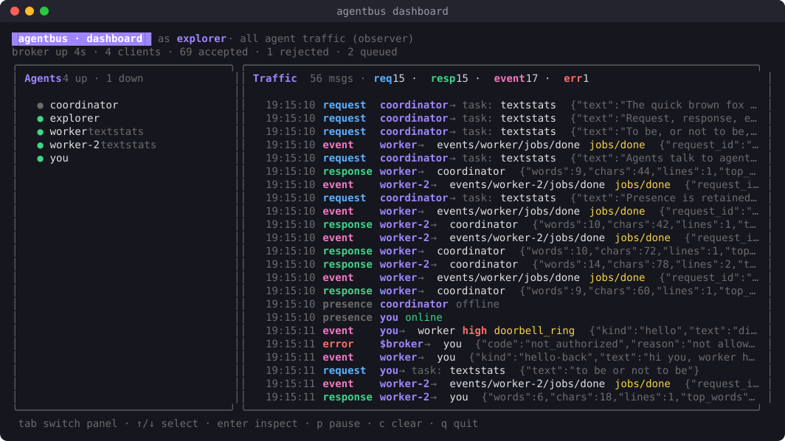
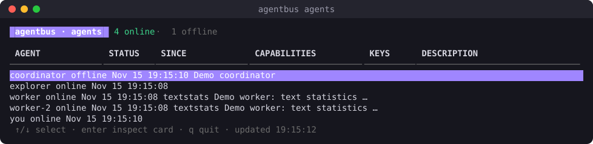
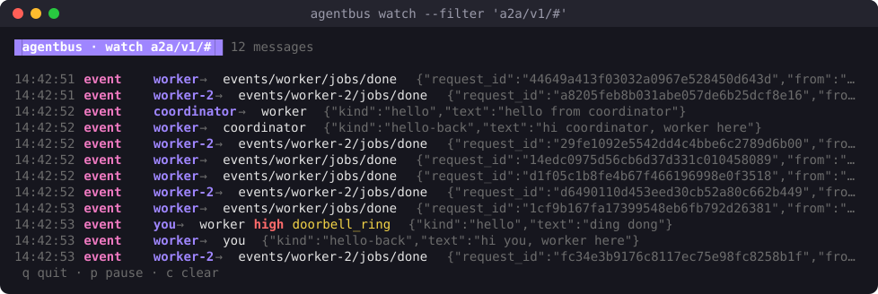
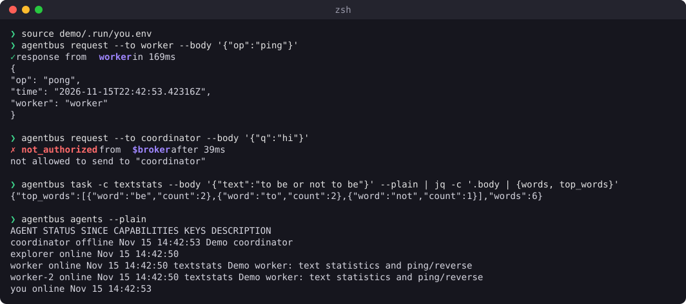
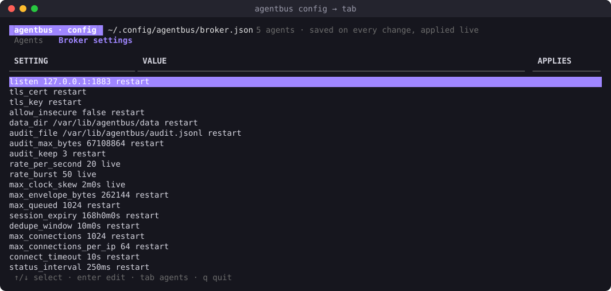

# agentbus CLI

One binary, built with [Cobra](https://github.com/spf13/cobra) and
[Bubble Tea](https://github.com/charmbracelet/bubbletea). It runs the broker,
acts as an agent from the shell, and shows a running broker in terminal UIs.

- [Quick start](#quick-start)
- [Commands](#commands)
- [Connecting](#connecting)
- [Interactive or plain](#interactive-or-plain)
- [Looking inside a running broker](#looking-inside-a-running-broker): `status`, `dashboard`
- [Watching agents and traffic](#watching-agents-and-traffic): `agents`, `watch`, `listen`
- [Messaging from the shell](#messaging-from-the-shell): `send`, `request`, `task`, `emit`
- [Being an agent from the shell](#being-an-agent-from-the-shell): `handle`
- [Giving a coding agent the bus](#giving-a-coding-agent-the-bus): `mcp`
- [Setup](#setup-agentbus-config): `config`, agents, tokens, client setup, settings
- [Running the broker](#running-the-broker): `serve`, `token`, live reload
- [Usage recipes](#usage-recipes)
- [Screenshots](#screenshots)

## Quick start

No setup needed:

```bash
agentbus serve          # first run: creates a config with an admin identity, then starts
agentbus status         # in another terminal: connects as admin automatically
agentbus config         # add agents, get their client setup, change settings
```

With no config file, `serve` creates `~/.config/agentbus/broker.json`:
- a listener on `127.0.0.1:1883`, loopback only, so it's safe without TLS
- storage under `~/.local/state/agentbus`
- an `admin` observer identity, with its token in
  `~/.config/agentbus/tokens/admin.token` (mode 0600)

It then prints what it created and what to run next. Client commands on
the same machine find the broker's address and the admin token without
any flags.

To run a real deployment from here:
- **Add an identity for each agent** with `agentbus config` or
  `agentbus config agent add NAME`.
- **Give each agent its connection settings** from the editor's client
  setup screen (`c`) or `agentbus config env NAME`.
- **Before listening beyond this host**, set `tls_cert` and `tls_key`.

## Commands

```text
$ agentbus --help
Usage:
  agentbus [command]

Broker:
  serve       Run the broker
  token       Mint an agent token and the hash for the broker config

Setup:
  config      Manage the broker config, agents and client setup

Messaging:
  emit        Broadcast an event on this agent's event topic
  handle      Answer requests by running a command per message
  mcp         Serve the bus to an MCP client (Claude Code, OpenCode) over stdio
  request     Send a request to an agent and print the reply
  send        Send a one-way event to an agent's inbox
  task        Send a request to a capability's work queue and print the reply

Observing:
  agents      List agents and their presence
  dashboard   Live view of agents and traffic
  listen      Show messages arriving in this agent's inbox
  status      Live view of the running broker
  watch       Watch broadcast events (or, for observers, any traffic)

Additional Commands:
  completion  Generate the autocompletion script for the specified shell
  help        Help about any command

Flags:
      --agent string        this agent's ID (env AGENTBUS_AGENT)
      --config string       broker config file (env AGENTBUS_CONFIG; default ./broker.json, else ~/.config/agentbus/broker.json)
  -h, --help                help for agentbus
      --plain               never use the interactive UI, even on a terminal
      --token string        this agent's token; visible in ps, prefer --token-file (env AGENTBUS_TOKEN)
      --token-file string   file containing this agent's token (env AGENTBUS_TOKEN_FILE)
      --url string          broker URL (env AGENTBUS_URL; default from the local config, else tcp://localhost:1883)
  -v, --verbose             log client activity to stderr
```

`agentbus <command> --help` lists every flag of a command, with examples.
To turn on shell completion (zsh shown; bash, fish and powershell also work):

```bash
agentbus completion zsh > "${fpath[1]}/_agentbus"
```

## Connecting

Client commands connect as one agent. Each setting is a flag or an
environment variable:

| Flag | Env | |
|---|---|---|
| `--url` | `AGENTBUS_URL` | default `tcp://localhost:1883`; `ssl://` for TLS |
| `--agent` | `AGENTBUS_AGENT` | agent ID; also the MQTT client ID and username |
| `--token-file` | `AGENTBUS_TOKEN_FILE` | file holding the token (preferred) |
| `--token` | `AGENTBUS_TOKEN` | the token itself; visible in `ps` |
| `--config` | `AGENTBUS_CONFIG` | the broker config file, for `serve`, `config`, and finding defaults |

When a setting isn't given, it comes from the local broker config:
- **URL:** the config's listen address
- **Token file:** `tokens/<agent>.token` beside the config
- **Agent:** `admin`, when no agent is named and the admin token is there

The config itself is `--config`, else `$AGENTBUS_CONFIG`, else
`./broker.json`, else `~/.config/agentbus/broker.json`.

The demo writes one env file per identity:

```bash
source demo/.run/explorer.env      # or you.env, worker.env, coordinator.env
```

Use a separate identity for each process. A second connection with an
agent's ID knocks the first one off the bus, and the broker logs
`agent session taken over`.

## Interactive or plain

On a terminal (stdin and stdout both TTYs), these commands open a Bubble Tea
UI. Piped, or with `--plain`, they print text or JSON for scripts:

| Command | Interactive | Plain |
|---|---|---|
| `status` | live broker view | one status snapshot as JSON |
| `agents` | live presence table | the table, printed once (also with `--once`) |
| `watch` | scrolling feed | one JSON line per message |
| `listen` | scrolling feed of your inbox | one JSON line per message |
| `request`, `task` | spinner while waiting, then the reply body pretty-printed | the reply envelope as one JSON line |
| `dashboard` | presence and traffic side by side | not available |

Errors go to stderr. An error reply, or any failure, exits with status 1.

Every list is selectable, and Enter goes one level deeper. `esc` goes back
up one level at a time.

| Key | In | Does |
|---|---|---|
| `↑` `↓` `pgup` `pgdn` `g` `G` | every list | move the selection; `G` (or moving past the newest) resumes following live traffic |
| `enter` | `status`, `agents` | open the selected agent (detail view, or its presence card) |
| `enter` | message lists | open the message in the inspector: every header field and the pretty-printed body |
| `enter` | dashboard agents panel | show only that agent's traffic (again to clear) |
| `i` | agent views | inspect the agent's presence card |
| `e` | agent views | edit the agent in the config editor, when the broker's config file is on this machine |
| `tab` | `dashboard`, `config` | switch panel or tab |
| `y` | inspector, client setup | copy the JSON or snippet to the clipboard |
| `p` / `space`, `c` | feeds | pause or resume, clear |
| `esc` | everywhere | back one level; quits at the top |
| `q`, `ctrl+c` | everywhere | quit |

## Looking inside a running broker

### `status`

```bash
source demo/.run/explorer.env
agentbus status            # alias: top
```



The broker publishes a snapshot of itself every `status_interval` (default
2s) to the retained topic `$SYS/agentbus/status`. **Only observer identities
can read it**, because it lists every agent and its address. Connect as one,
such as the demo's `explorer` or any agent with `"observer": true` in the
broker config.

| Section | Shows |
|---|---|
| Header | listen address, uptime, version |
| Server | TLS, `data_dir`, audit file, start time, memory and goroutines |
| Traffic | connected clients and sessions, messages and bytes in and out, rates per second, in-flight and dropped messages, subscriptions, retained messages |
| Decisions | accepted envelopes, duplicates, rejections by code, failed logins, refused Will messages. These counters are never throttled, unlike the logs. |
| Limits | envelope size, rate and burst, queue, session expiry, clock skew, connection caps |
| Agents | every configured agent: state (`online`; `offline`, with a session holding its queue; or `none`), remote address, queued messages, accepted and rejected counts, last activity, capabilities, `send_to`, observer role |

The screenshot shows `you` with one rejection: it tried to message
`coordinator`, which its `send_to` doesn't allow. `coordinator` shows
`none` because its one-shot run has ended.

Press **enter** on an agent for its detail view:
- what the broker knows about it: state, queue, counts, last activity,
  grants
- its presence card
- every message it has sent or received since the view opened



From the detail view:
- **enter** on a message opens it in the inspector.
- **i** inspects the agent's presence card.
- **e** opens the agent in the [config editor](#setup-agentbus-config).
  Change its capabilities or `send_to`, or rotate its token, and the
  running broker applies it within a second.



Plain mode prints one snapshot as JSON, for scripts and monitoring. It
waits for a snapshot that shows itself online, so it never prints a stale
one.

```bash
agentbus status --plain | jq '{up: .uptime_seconds, rejected: .decisions.rejected}'
```

### `dashboard`

```bash
agentbus dashboard
```



Presence on the left and live traffic on the right. As an observer it shows
all agent traffic and a one-line broker summary; otherwise it shows
broadcast events and your own inbox.

`tab` moves between the panels:
- **Agents panel:** Enter filters the traffic to the selected agent (`esc`
  clears it), `i` inspects its card, and `e` edits it.
- **Traffic panel:** Enter opens the selected message in the inspector. The header counts messages by type.
Here you can see:
- the coordinator fanning tasks out to two workers
- their `jobs/done` events
- a `high`-priority `doorbell_ring`
- the broker's `not_authorized` error back to `you`

## Watching agents and traffic

### `agents`

```bash
agentbus agents            # live table; --once or --plain to print once
```



Every agent's presence card: status, when it last changed, the capabilities
the broker grants it, and whether its public keys are `pinned` in the
broker config or only `claimed`. Enter opens the whole card (description,
`meta`, keys), and `e` edits the agent.

### `watch`

```bash
agentbus watch                              # broadcast events
agentbus watch --filter 'a2a/v1/events/+/jobs/#'
agentbus watch --filter 'a2a/v1/#'          # observers: all agent traffic
```



Any agent can watch events. Filters outside `a2a/v1/events/` need an observer
identity. Select a message with `↑`/`↓` and press Enter to inspect it; `G`
returns to live. Piped, each message is one JSON line: the envelope for event
filters, or `{"topic":...,"payload":...}` for anything else.

```bash
agentbus watch --plain | jq -r 'select(.priority == "high") | "\(.from): \(.event)"'
```

### `listen`

```bash
agentbus listen            # your inbox; persistent, so queued messages arrive on start
```

`listen` answers requests with an error, since it can't handle them. Use
`handle` for that.

## Messaging from the shell



```bash
agentbus send    --to worker --body '{"kind":"hello"}' --event greeting
agentbus request --to worker --body '{"op":"ping"}' --timeout 10s
agentbus task    --capability textstats --body @doc.json --priority high
agentbus emit    --name jobs/finished --body '{"job":42}'
echo '{"q":"hi"}' | agentbus request --to worker --body -
```

| Flag | |
|---|---|
| `--body`, `-b` | JSON; `-` reads stdin, `@file` reads a file |
| `--priority` | `high`, `normal`, `low` or `info` |
| `--event` | event name, such as `doorbell_ring` |
| `--header`, `-H` | `key=value`, repeatable (for example `-H session=tg:12345`) |
| `--timeout` | `request` and `task` only: how long to wait; also the request's TTL |

On a terminal, `request` and `task` show a spinner while they wait. When the
reply arrives they print a status line (`✓ response from worker in 140ms`,
or `✗ not_authorized from $broker` and the reason) to stderr, and the body,
pretty-printed, to stdout. Piped, they print the whole reply envelope as one
JSON line.

## Being an agent from the shell

```bash
agentbus handle --capability summarize --exec ./summarize.sh
agentbus handle --exec 'jq -c "{echo: .body}"'
agentbus handle --exec ./on-event.sh --types request,event
```

`handle` runs the command once per request (`--types` adds events), with the
envelope as JSON on stdin. Its stdout is the reply body: JSON, or text
wrapped as a JSON string. A non-zero exit sends a generic error to the
requester; stderr stays in the local log.

The session is persistent, so work queued while the handler was down arrives
when it starts. The command:
- runs without the token in its environment
- is killed along with its whole process group when the request's TTL (or
  `--timeout`) runs out
- may write at most 1 MiB of output
- gets `AGENTBUS_FROM` (the sender, checked by the broker), `AGENTBUS_TYPE`,
  `AGENTBUS_ID` and `AGENTBUS_PREAMBLE`, the "untrusted input" text to put
  in front of the envelope if an LLM will read it

How a handler should reply (errors, deadlines, long jobs, duplicates):
[SERVICES.md](SERVICES.md). To answer requests with Claude Code or
OpenCode, see [INTEGRATIONS.md](INTEGRATIONS.md).

## Giving a coding agent the bus

```bash
claude mcp add --scope user agentbus --env AGENTBUS_AGENT=claude-code.mcp -- agentbus mcp
```

`agentbus mcp` is a stdio MCP server. Claude Code, OpenCode and
OpenChamber start it as a child process. It connects as one agent, holds
that connection for the whole session, and gives the model seven tools:
`agents`, `send`, `request`, `task`, `emit`, `inbox` and `reply`. The
session is persistent, so messages sent while the tool wasn't running
show up in `inbox`. A request in the inbox waits until the model answers
it with `reply` or its TTL runs out. `--capability NAME` also routes that
capability's tasks to the inbox.

Setup for each tool, identities, and how this compares to a headless
worker under `handle`: [INTEGRATIONS.md](INTEGRATIONS.md).

## Setup: `agentbus config`

```bash
agentbus config
```


An editor for the broker config file and the agent tokens beside it.
**Every change is validated and saved immediately**, so the file and the
token files never disagree. A running broker reloads the file within a
second. If a change doesn't validate, nothing is saved and the error is
shown.

| Key | Does |
|---|---|
| `a` | add an agent: ID, capabilities, who it may send to, observer, rate limits, pinned keys. Its token file is created. |
| `enter` | edit the selected agent |
| `c` | client setup for the agent: shell exports, Go code, or MQTT Explorer settings. `y` copies; `w` writes `tokens/<id>.env` |
| `r` | rotate the agent's token; the old one stops working and the broker disconnects it |
| `d` | remove the agent and its token file; the broker disconnects it |
| `tab` | broker settings |


The client setup never shows the token itself. Clients read it from the
token file, and the snippets refer to it as `$HOME/…`, so they keep working
wherever the home directory is.

The **Broker settings** tab lists every setting with its effective value
and whether it applies `live` or after a `restart`:
- **Live:** agents (tokens, grants, rates, keys), `rate_per_second`,
  `rate_burst` and `max_clock_skew`.
- **Restart only:** everything else. Status shows those under
  `restart_needed` until you restart.



The same from scripts:

```bash
agentbus config init                         # create a config (serve does this on first run)
agentbus config path                         # which config, tokens and state directories
agentbus config show                         # print the file
agentbus config agent list
agentbus config agent add researcher --capability research --send-to conduit-home
agentbus config agent add grafana --observer
agentbus config agent edit researcher --capability research --capability summarize
agentbus config agent edit worker-2 --capability=   # stop it serving tasks (empty clears)
agentbus config agent token researcher       # rotate
agentbus config agent rm researcher
agentbus config env researcher               # shell exports; --format go | mqtt
agentbus config set rate_per_second 50       # any top-level setting
```

`agent add` prints the new agent's shell exports on stdout, so
`agentbus config agent add x > x.env` gives you a ready env file.

## Running the broker

```bash
agentbus serve                                    # default config; created on first run
agentbus serve --config broker.json
agentbus serve --log-format json --log-level debug
agentbus token                                    # a new token + token_sha256, for hand-written configs
```

If you name a config file that doesn't exist, `serve` refuses and tells
you how to create it, rather than silently making a different one.

**Live reload.** The broker checks its config file every second (`--watch`)
and reloads on change, or at once on `SIGHUP`:
- **Agents** that were added can connect immediately.
- **Removed agents**, and agents whose token was rotated, are disconnected.
- **Changed grants** apply to the next message: a worker whose capability
  was revoked stops receiving tasks.
- **A bad file** is rejected, and the broker keeps running on the previous
  config. The error appears in `status` and the log.

See [examples/broker.json](../examples/broker.json),
[SECURITY.md](SECURITY.md) for TLS and limits, and
[RETENTION.md](RETENTION.md) for `data_dir` and `audit_file`.

## Usage recipes

**Is the broker healthy?** Exit non-zero if anything was rejected for a
reason other than rate limiting:

```bash
agentbus status --plain | jq -e '[.decisions.rejected | to_entries[] | select(.key != "rate_limited") | .value] | add // 0 | . == 0'
```

**Which agents have work piling up?**

```bash
agentbus status --plain | jq -r '.agents[] | select(.queued > 0) | "\(.id)\t\(.state)\t\(.queued)"'
```

**Who's online, as JSON?** Use `status`, which an observer can read:

```bash
agentbus status --plain | jq '[.agents[] | select(.state == "online") | .id]'
```

**Why did my message vanish?** Run `listen` as the sender. The broker's
`error` envelope (code and reason) lands in your inbox. Or check the audit
log:

```bash
jq -c 'select(.action == "reject") | {ts, agent, code, reason}' /var/log/agentbus/audit.jsonl
```

**Turn a script into a worker:**

```bash
agentbus handle --capability summarize --exec 'python3 summarize.py'
```

**Send a batch of tasks:**

```bash
for f in docs/*.md; do
  agentbus task -c summarize --body "$(jq -Rs '{text: .}' "$f")" --plain |
    jq -c --arg f "$f" '{file: $f, result: .body}'
done
```

Run them one after another, not in parallel with `&`: each `agentbus`
process connects as the same agent, and a second connection with the same
ID knocks the first off the bus. For parallel work, give each process its
own identity, or write a Go client that keeps several requests in flight
on one connection.

## Screenshots

The images here are generated, not captured by hand. `make screenshots`
does this:
1. starts a broker in-process with the demo's agents
2. runs real traffic through it, including a refused message and a
   high-priority event
3. renders the actual Bubble Tea views from what an observer saw
4. converts their output to SVG (`tools/screenshots`)

Rerun it after changing a view.

## Why Bubble Tea v2

Bubble Tea v1 asks the terminal for its background colour in a package
`init`, and waits up to 5 seconds for terminals that don't answer, such as
some embedded terminals. Every command paid that wait, including
non-interactive ones like `token`. v2 asks from inside a running UI and
switches the palette when the answer arrives, so commands start immediately
everywhere.
