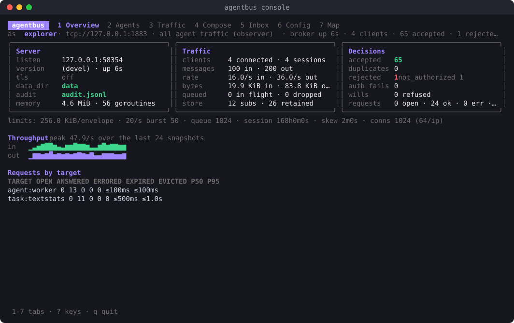
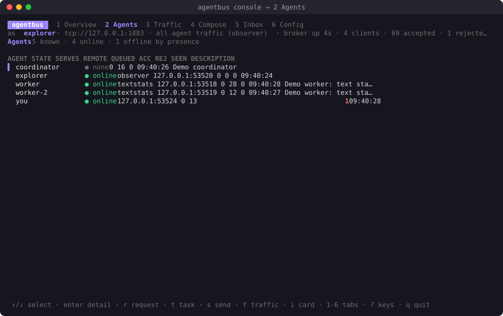
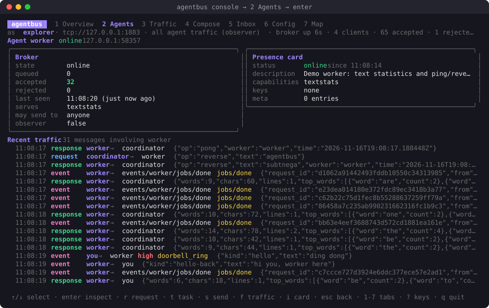
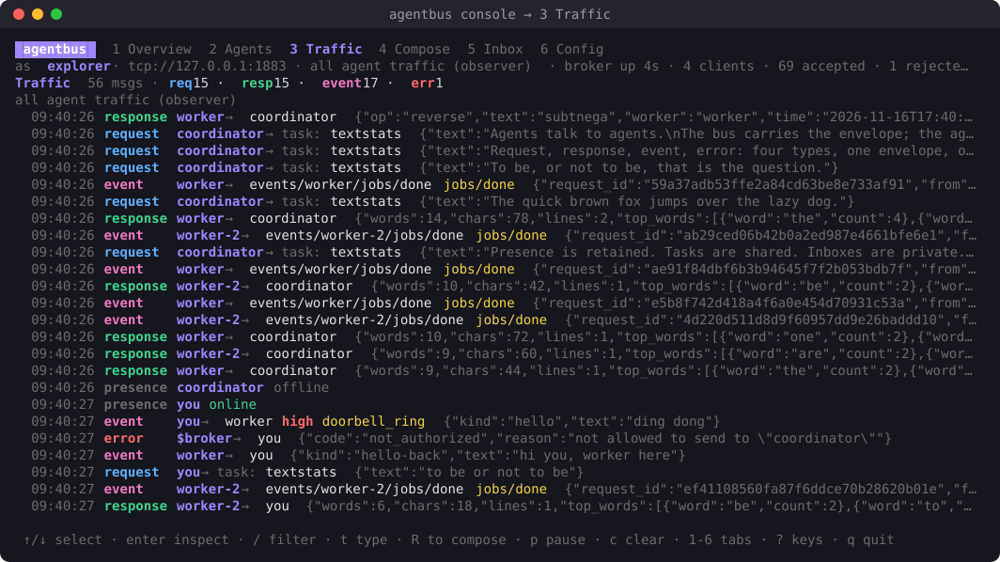
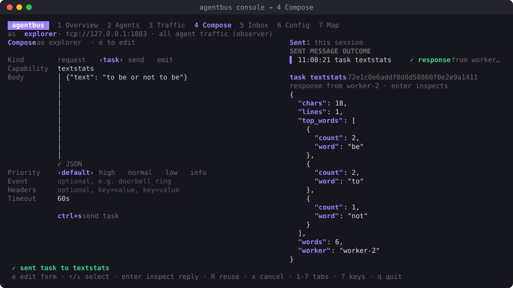
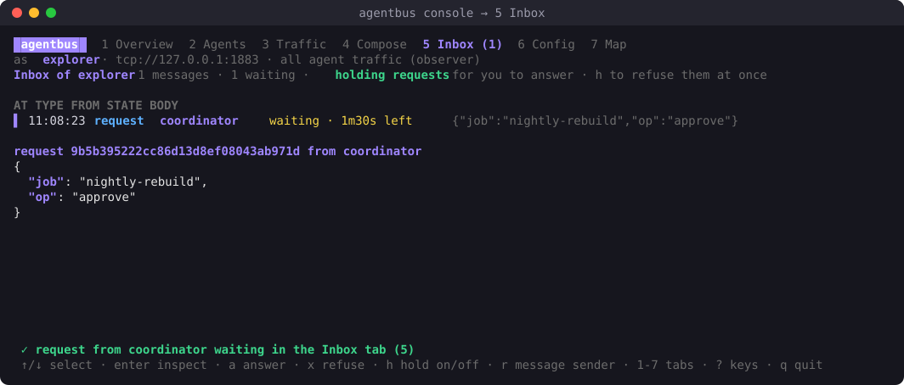
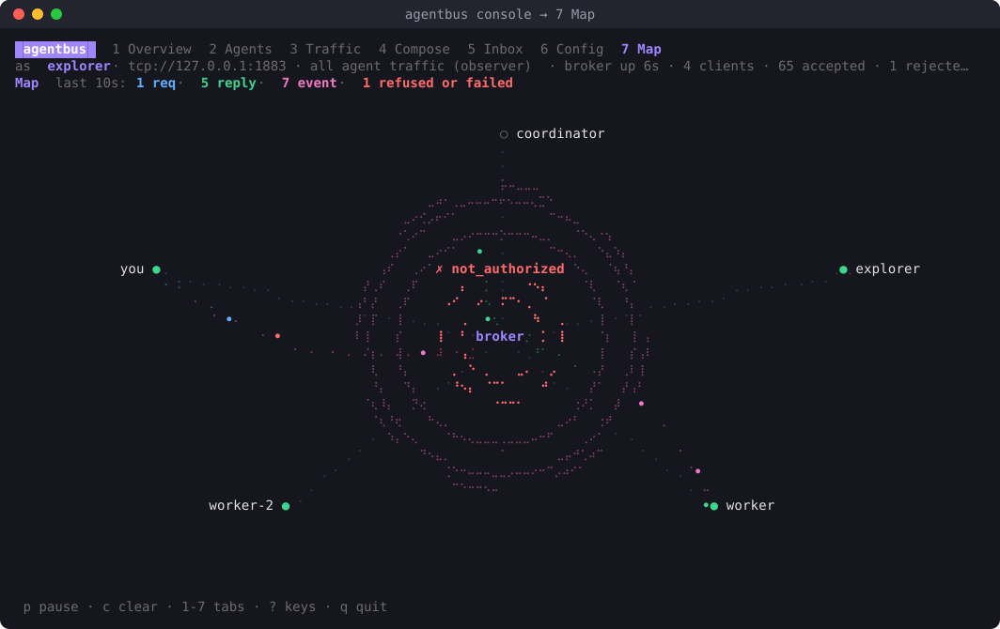
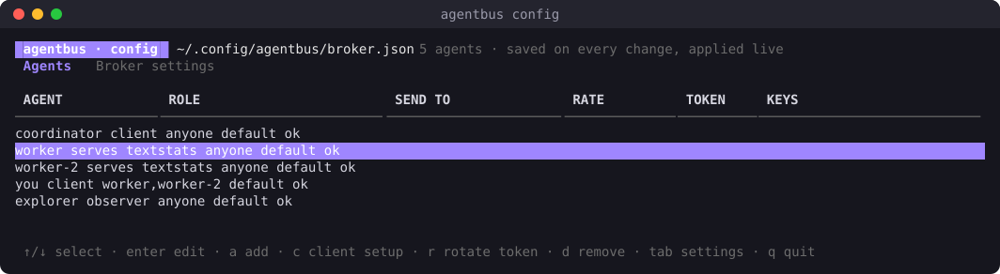
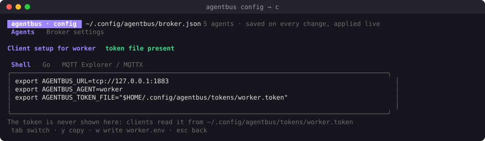

# agentbus CLI

One binary, built with [Cobra](https://github.com/spf13/cobra) and
[Bubble Tea](https://github.com/charmbracelet/bubbletea). It runs the broker,
acts as an agent from the shell, and shows a running broker in terminal UIs.

- [Quick start](#quick-start)
- [Commands](#commands)
- [Connecting](#connecting)
- [Interactive or plain](#interactive-or-plain)
- [The console](#the-console): `console`, and `status` and `agents` on a terminal
- [Watching traffic from the shell](#watching-traffic-from-the-shell): `watch`, `listen`
- [Messaging from the shell](#messaging-from-the-shell): `send`, `request`, `task`, `emit`
- [Being an agent from the shell](#being-an-agent-from-the-shell): `handle`
- [Giving a coding agent the bus](#giving-a-coding-agent-the-bus): `mcp`
- [Standalone agents](#standalone-agents): `agent init`, `run`, `build`, `check`
- [Setup](#setup-agentbus-config): `config`, agents, tokens, client setup, settings
- [Running the broker](#running-the-broker): `serve`, `token`, live reload
- [Usage recipes](#usage-recipes)
- [Screenshots](#screenshots)

## Quick start

No setup needed:

```bash
agentbus serve          # first run: creates a config with an admin identity, then starts
agentbus console        # in another terminal: connects as admin automatically
agentbus config         # add agents, get their client setup, change settings
```

With no config file, `serve` creates `~/.config/agentbus/broker.json`:
- a listener on `127.0.0.1:1883`, loopback only, so it's safe without TLS
- storage under `~/.local/state/agentbus`
- an `admin` observer identity, with its token in
  `~/.config/agentbus/tokens/admin.token` (mode 0600)

It then prints what it created and what to run next. Client commands on
the same machine find the broker's address and the admin token without
any flags.

To run a real deployment from here:
- **Add an identity for each agent** with `agentbus config` or
  `agentbus config agent add NAME`. Both then show where the new token
  file is and the exact commands that start the agent, on this machine and
  on another host. See [Onboarding an agent](#onboarding-an-agent).
- **Before listening beyond this host**, set `tls_cert` and `tls_key`.

## Commands

```text
$ agentbus --help
Usage:
  agentbus [command]

Broker:
  serve       Run the broker
  token       Mint an agent token and the hash for the broker config

Setup:
  config      Manage the broker config, agents and client setup

Messaging:
  emit        Broadcast an event on this agent's event topic
  handle      Answer requests by running a command per message
  mcp         Serve the bus to an MCP client (Claude Code, OpenCode) over stdio
  request     Send a request to an agent and print the reply
  send        Send a one-way event to an agent's inbox
  task        Send a request to a capability's work queue and print the reply

Observing:
  agents      List agents and their presence
  console     Manage the bus from one full-screen console
  listen      Show messages arriving in this agent's inbox
  status      Live view of the running broker
  watch       Watch broadcast events (or, for observers, any traffic)

Standalone agents:
  agent       Build and run standalone agents that serve topics with shell, Python or Go handlers

Additional Commands:
  completion  Generate the autocompletion script for the specified shell
  help        Help about any command

Flags:
      --agent string        this agent's ID (env AGENTBUS_AGENT)
      --config string       broker config file (env AGENTBUS_CONFIG; default ~/.config/agentbus/broker.json)
  -h, --help                help for agentbus
      --plain               never use the interactive UI, even on a terminal
      --token string        this agent's token; visible in ps, prefer --token-file (env AGENTBUS_TOKEN)
      --token-file string   file containing this agent's token (env AGENTBUS_TOKEN_FILE)
      --url string          broker URL (env AGENTBUS_URL; default from the local config, else tcp://localhost:1883)
  -v, --verbose             log client activity to stderr
```

`agentbus <command> --help` lists every flag of a command, with examples.
To turn on shell completion (zsh shown; bash, fish and powershell also work):

```bash
agentbus completion zsh > "${fpath[1]}/_agentbus"
```

## Connecting

Client commands connect as one agent. Each setting is a flag or an
environment variable:

| Flag | Env | |
|---|---|---|
| `--url` | `AGENTBUS_URL` | default `tcp://localhost:1883`; `ssl://` for TLS |
| `--agent` | `AGENTBUS_AGENT` | agent ID; also the MQTT client ID and username |
| `--token-file` | `AGENTBUS_TOKEN_FILE` | file holding the token (preferred) |
| `--token` | `AGENTBUS_TOKEN` | the token itself; visible in `ps` |
| `--config` | `AGENTBUS_CONFIG` | the broker config file, for `serve`, `config`, and finding defaults |
| | `AGENTBUS_CONFIG_DIR` | the directory holding `broker.json` and `tokens/`; default `~/.config/agentbus` |
| | `AGENTBUS_STATE_DIR` | where a new config puts `data_dir` and the audit log; default `~/.local/state/agentbus` |

A flag beats an environment variable: `--token` is used even when
`AGENTBUS_TOKEN_FILE` is set, and `--token-file` even when `AGENTBUS_TOKEN`
is. A relative `--config` or `AGENTBUS_CONFIG` is taken from the current
directory, and the paths derived from it are absolute.

When a setting isn't given, it comes from the local broker config:
- **URL:** the config's listen address
- **Token file:** `tokens/<agent>.token` beside the config
- **Agent:** `admin`, when no agent is named and the admin token is there

The config is found in this order:
1. `--config FILE`
2. `$AGENTBUS_CONFIG`, a file
3. `broker.json` in `$AGENTBUS_CONFIG_DIR`
4. `~/.config/agentbus/broker.json`

The current directory is never searched, so `serve`, `console` and every
other command find the same file wherever you run them. `agentbus config
path` shows which file is in use and why.

`AGENTBUS_CONFIG_DIR` moves the whole directory: the config and the
`tokens/` beside it. Use it for a broker on a server (`/etc/agentbus`, see
[On a server](#on-a-server)) or for a second broker on one machine. When
`serve` or `config init` creates a config there, the broker's data and
audit log go in a `state/` directory beside it, so two brokers never share
a data directory. `AGENTBUS_STATE_DIR` puts them somewhere else
(`/var/lib/agentbus`). It only matters when a config is created; after
that, `data_dir` and `audit_file` in the config decide.

Standalone agents (`agentbus agent run` and the generated programs) also
look for their token in `$AGENTBUS_CONFIG_DIR/tokens/<agent>.token` before
`/etc/agentbus/<agent>.token`.

Variables set in your shell are easy to forget. On a terminal, every
command prints one line naming the `AGENTBUS_*` variables it is using, and
the console shows them in its header. A failed connection lists the config,
URL, agent and token it tried, and where each came from:

```text
agentbus: connect tcp://127.0.0.1:18830: not Authorized
  config /home/you/demo/.run/broker.json ($AGENTBUS_CONFIG)
  url    tcp://127.0.0.1:18830 ($AGENTBUS_URL)
  agent  explorer ($AGENTBUS_AGENT)
  token  /home/you/demo/.run/tokens/explorer.token ($AGENTBUS_TOKEN_FILE)
  Settings from AGENTBUS_* variables may be left over from an earlier shell session; unset them to use /home/you/.config/agentbus/broker.json.
```

To go back to the default setup, unset them:

```bash
unset AGENTBUS_CONFIG AGENTBUS_URL AGENTBUS_AGENT AGENTBUS_TOKEN_FILE AGENTBUS_TOKEN
```

The demo writes one env file per identity:

```bash
source demo/.run/explorer.env      # or you.env, worker.env, coordinator.env
```

Use a separate identity for each process. A second connection with an
agent's ID knocks the first one off the bus, and the broker logs
`agent session taken over`.

## Interactive or plain

On a terminal (stdin and stdout both TTYs), these commands open a Bubble Tea
UI. Piped, or with `--plain`, they print text or JSON for scripts:

| Command | Interactive | Plain |
|---|---|---|
| `console` (also `ui`, `dashboard`) | the console | not available |
| `status` | the console, on its Overview tab | one status snapshot as JSON |
| `agents` | the console, on its Agents tab | the table, printed once (also with `--once`) |
| `watch` | scrolling feed | one JSON line per message |
| `listen` | scrolling feed of your inbox | one JSON line per message |
| `request`, `task` | spinner while waiting, then the reply body pretty-printed | the reply envelope as one JSON line |
| `config` | the config editor | `config show` and the other subcommands |

Errors go to stderr. An error reply, or any failure, exits with status 1.

Text that comes from other agents (presence descriptions and metadata,
event names, headers, error reasons, message bodies) is shown with control
characters escaped, as `\x1b` for example, so it can't move the cursor,
change the terminal, or add rows to `agents --plain` output. JSON output is
left as JSON.

## The console

```bash
agentbus console                       # as admin, found next to the local config
agentbus console --tab compose --agent you
```

One full-screen program for running the bus. It connects as one agent and
has seven tabs:

| Tab | What it is for |
|---|---|
| 1 Overview | broker status: server, traffic, decisions, limits, throughput over time, and request outcomes by target |
| 2 Agents | every agent, joining what the broker reports with its presence card; a detail view with its recent traffic |
| 3 Traffic | every message the connection can see, filtered by agent, type or text |
| 4 Compose | send a request, task, one-way event or broadcast, and see each reply |
| 5 Inbox | messages sent to the console's agent; answer or refuse requests |
| 6 Config | the [config editor](#setup-agentbus-config), when the broker's config file is on this machine |
| 7 Map | a live drawing of the bus: each message moving from its sender through the broker to its recipient |

What it can see depends on the identity. **Observers** (`admin` is one)
see all agent traffic and the broker's status snapshots. Any other agent
sees broadcast events and its own inbox: Overview explains this, and the
broker columns in Agents stay empty. Compose and Inbox work for every
agent, within its `send_to` grants.

### Keys

`1`-`7` or `[` and `]` switch tabs from anywhere. `?` lists every key.
While a text field has focus (Compose, a filter, an answer), keys go to the
field and `esc` leaves it.

| Key | In | Does |
|---|---|---|
| `↑` `↓` `pgup` `pgdn` `g` `G` | every list | move the selection; in a feed, `G` (or moving past the newest) resumes following live traffic |
| `enter` | Agents | the agent's detail: broker state, presence card, recent traffic |
| `enter` | message lists, Compose results | open the message in the inspector: every header field and the pretty-printed body |
| `r` `t` `s` | Agents | open Compose with a request, a task (to the agent's first capability) or a one-way event to the agent |
| `f` | Agents | show the agent's traffic in the Traffic tab |
| `i` | Agents | inspect the agent's presence card |
| `e` | Agents | edit the agent in the Config tab |
| `/`, `t` | Traffic | filter by text (topic, sender, recipient, IDs, body), or cycle through types |
| `R` | Traffic, Compose results | copy a message into the Compose form |
| `p` / `space`, `c` | feeds | pause or resume, clear |
| `tab`, `shift+tab` | Compose form | next or previous field; in the target field, `tab` first completes a known agent or capability |
| `←` `→` | Compose form | change the kind or priority |
| `ctrl+s` | Compose form, an answer | send |
| `x` | Compose results | cancel a request still waiting |
| `a`, `x` | Inbox | answer or refuse the selected request |
| `h` | Inbox | hold requests for you to answer, or refuse them at once |
| `y` | inspector, client setup | copy the JSON or snippet to the clipboard |
| `esc` | everywhere | back one level: leave a field, close the inspector, clear a filter, leave a detail |
| `q` | anywhere but a text field | quit |
| `ctrl+c` | everywhere | quit |

### Overview



The broker publishes a snapshot of itself every `status_interval` (default
2s) to the retained topic `$SYS/agentbus/status`. **Only observer identities
can read it**, because it lists every agent and its address.

| Section | Shows |
|---|---|
| Server | listen address, version and uptime, TLS, `data_dir`, audit file, memory and goroutines |
| Traffic | connected clients and sessions, messages and bytes in and out, rates per second, in-flight and dropped messages, subscriptions, retained messages |
| Decisions | accepted envelopes, duplicates, rejections by code, failed logins, refused Will messages, and request outcomes. These counters are never throttled, unlike the logs. |
| Limits | envelope size, rate and burst, queue, session expiry, clock skew, connection caps |
| Throughput | message rates in and out, one bar per snapshot since the console started |
| Requests by target | for each agent inbox and task queue: open requests, answered, errored, expired, evicted, and p50 and p95 reply latency |

`agentbus status --plain` prints one snapshot as JSON, for scripts and
monitoring. It waits for a snapshot that shows itself online, so it never
prints a stale one.

```bash
agentbus status --plain | jq '{up: .uptime_seconds, rejected: .decisions.rejected}'
```

### Agents



One row per agent, from the broker's status (state, address, queue,
accepted and rejected counts, last activity, grants) and its presence card
(description). State is `online`; `offline`, with a session holding its
queue; or `none`. An agent with no presence card has never announced
itself.

Enter opens the agent's detail, with every message it has sent or received
since the console started. Enter on one of those opens the inspector.




### Traffic



As an observer, every message on `a2a/v1/#`: requests, replies, events,
presence cards, and the broker's own errors. The header counts messages by
type. `/` filters by text and `t` by type; `f` on an agent in the Agents
tab filters by agent. `esc` clears the filters one at a time.

In the screenshot:
- the coordinator fans tasks out to two workers
- the workers emit `jobs/done` events
- `you` sends a `high`-priority `doorbell_ring`
- the broker sends `not_authorized` back to `you`

### Compose



A form for the four ways to send:

| Kind | Goes to | Waits for a reply |
|---|---|---|
| request | an agent's inbox | yes, up to the timeout, which is also the request's TTL |
| task | a capability's work queue; one worker takes it | yes |
| send | an agent's inbox, as a one-way event | no |
| emit | this agent's event topic, for anyone watching | no |

The body is JSON, checked as you type; blank sends no body. Priority,
event name and headers (`key=value, key=value`) are optional.

Each message stays in the list on the right with its outcome: the reply
and how long it took, the error code and reason, or no reply within the
timeout. A send or emit the broker refuses (`not_authorized` when
`send_to` doesn't allow it, for example) shows the refusal too: the broker
sends it to the console's inbox, and the console matches it to the message.

### Inbox



Every message sent to the console's agent arrives here, including the
broker's refusals. A request **waits for you**: `a` answers it with a JSON
body and `x` refuses it with a reason, which the requester gets as an
error with code `refused`. A request nobody answers before its TTL runs
out gets a `timeout` error. Press `h` to refuse requests at once instead,
with code `not_answering`.

This is useful for testing an agent that asks other agents things: point
it at the console's identity and answer by hand.

### Config

The [config editor](#setup-agentbus-config), as a tab. It's there when the
broker config file on this machine is the one for the broker the console
is connected to (the same listen address), so the console never edits some
other broker's config.

### Map

```bash
agentbus console --tab map
```



The bus as it runs, drawn in braille dots: the broker in the middle with
its rings turning, and every agent around it, green when online. Each
message the connection sees travels from its sender to the broker and on
to its recipient, colored by type: requests blue, replies green, events
magenta, errors red. An agent's marker lights up as a message reaches it.

What the broker does with a message shows at the broker:
- **A task** stops there, tagged `⇢ capability`. The broker hands it to
  one worker on the shared queue, and an observer can't see which; the
  reply then comes from that worker.
- **An event** ripples out from the broker to whoever subscribes.
- **A refusal** flashes the broker's rings red, stamps `✗` and the code
  above it (`✗ not_authorized`), and the error travels back to the
  sender.

The header counts each type over the last 10 seconds. `p` pauses the
drawing and `c` clears it. The map redraws 15 times a second, and only
while the tab is showing.

As with Traffic, an observer sees everything; any other agent sees only
broadcast events and its own inbox.

## Watching traffic from the shell

### `watch`

```bash
agentbus watch                              # broadcast events
agentbus watch --filter 'a2a/v1/events/+/jobs/#'
agentbus watch --filter 'a2a/v1/#'          # observers: all agent traffic
```


`watch` is the Traffic tab on its own, for one filter. Any agent can watch events. Filters outside `a2a/v1/events/` need an observer
identity. Select a message with `↑`/`↓` and press Enter to inspect it; `G`
returns to live. Piped, each message is one JSON line: the envelope for event
filters, or `{"topic":...,"payload":...}` for anything else.

```bash
agentbus watch --plain | jq -r 'select(.priority == "high") | "\(.from): \(.event)"'
```

### `listen`

```bash
agentbus listen            # your inbox; persistent, so queued messages arrive on start
```

`listen` answers requests with an error, since it can't handle them. Use
`handle` for that.

## Messaging from the shell


```bash
agentbus send    --to worker --body '{"kind":"hello"}' --event greeting
agentbus request --to worker --body '{"op":"ping"}' --timeout 10s
agentbus task    --capability textstats --body @doc.json --priority high
agentbus emit    --name jobs/finished --body '{"job":42}'
echo '{"q":"hi"}' | agentbus request --to worker --body -
```

| Flag | |
|---|---|
| `--body`, `-b` | JSON; `-` reads stdin, `@file` reads a file |
| `--priority` | `high`, `normal`, `low` or `info` |
| `--event` | event name, such as `doorbell_ring` |
| `--header`, `-H` | `key=value`, repeatable (for example `-H session=tg:12345`) |
| `--timeout` | `request` and `task` only: how long to wait; also the request's TTL |

On a terminal, `request` and `task` show a spinner while they wait. When the
reply arrives they print a status line (`✓ response from worker in 140ms`,
or `✗ not_authorized from $broker` and the reason) to stderr, and the body,
pretty-printed, to stdout. Piped, they print the whole reply envelope as one
JSON line.

## Being an agent from the shell

```bash
agentbus handle --capability summarize --exec ./summarize.sh
agentbus handle --exec 'jq -c "{echo: .body}"'
agentbus handle --exec ./on-event.sh --types request,event
```

`handle` runs the command once per request (`--types` adds events), with the
envelope as JSON on stdin. Its stdout is the reply body: JSON, or text
wrapped as a JSON string. Exiting 3 with `{"code": "...", "reason": "..."}`
on stdout refuses with that error; any other non-zero exit sends a generic
error to the requester. stderr stays in the local log. Besides
`AGENTBUS_FROM`, the command gets `AGENTBUS_OP` (the body's `op`) and, for
bodies up to 32 KiB, `AGENTBUS_BODY`.

The session is persistent, so work queued while the handler was down arrives
when it starts. The command:
- runs without the token in its environment
- is killed along with its whole process group when the request's TTL (or
  `--timeout`) runs out
- may write at most 1 MiB of output
- gets `AGENTBUS_FROM` (the sender, checked by the broker), `AGENTBUS_TYPE`,
  `AGENTBUS_ID` and `AGENTBUS_PREAMBLE`, the "untrusted input" text to put
  in front of the envelope if an LLM will read it

How a handler should reply (errors, deadlines, long jobs, duplicates):
[SERVICES.md](SERVICES.md). To answer requests with Claude Code or
OpenCode, see [INTEGRATIONS.md](INTEGRATIONS.md).

## Standalone agents

```bash
agentbus agent init disk-agent                       # project: manifest, Go/Python/shell examples, systemd unit
agentbus agent run -f agent.yaml                     # serve a manifest from disk, no build
agentbus agent build --target linux/amd64,linux/arm64  # static binaries in dist/, manifest and scripts inside
agentbus agent check -f agent.yaml                   # manifest, scripts and interpreters on this host
```

A manifest (`agent.yaml`) maps topics to handlers. A topic is a task
queue, an inbox op or an event filter. A handler is a shell command, a
script (sh, bash, python3, or anything with a shebang) or a Go function
compiled into a built agent. Scripts use the same contract as `handle`,
and exiting 3 with `{"code", "reason"}` on stdout chooses the error the
requester sees. The full guide is [AGENTS.md](AGENTS.md).

## Giving a coding agent the bus

```bash
claude mcp add --scope user agentbus --env AGENTBUS_AGENT=claude-code.mcp -- agentbus mcp
```

`agentbus mcp` is a stdio MCP server. Claude Code, OpenCode and
OpenChamber start it as a child process. It connects as one agent, holds
that connection for the whole session, and gives the model seven tools:
`agents`, `send`, `request`, `task`, `emit`, `inbox` and `reply`. The
session is persistent, so messages sent while the tool wasn't running
show up in `inbox`. A request in the inbox waits until the model answers
it with `reply` or its TTL runs out. `--capability NAME` also routes that
capability's tasks to the inbox.

Setup for each tool, identities, and how this compares to a headless
worker under `handle`: [INTEGRATIONS.md](INTEGRATIONS.md).

## Setup: `agentbus config`

```bash
agentbus config
```



An editor for the broker config file and the agent tokens beside it.
**Every change is validated and saved immediately**, so the file and the
token files never disagree. A running broker reloads the file within a
second. If a change doesn't validate, nothing is saved and the error is
shown.

| Key | Does |
|---|---|
| `a` | add an agent: ID, capabilities, who it may send to, observer, rate limits, pinned keys. Its token file is created, and the setup screen opens on **Start**. |
| `enter` | edit the selected agent |
| `c` | setup for the agent. **Start**: where its token is and how to start it. Then shell exports, Go code, and MQTT Explorer settings. `y` copies; `w` writes `tokens/<id>.env` |
| `r` | rotate the agent's token; the old one stops working and the broker disconnects it. The setup screen opens, because clients need the new token. |
| `d` | remove the agent and its token file; the broker disconnects it |
| `tab` | broker settings |



The client setup never shows the token itself. Clients read it from the
token file, and the snippets refer to it as `$HOME/…`, so they keep working
wherever the home directory is.

The **Broker settings** tab lists every setting with its effective value
and whether it applies `live` or after a `restart`:
- **Live:** agents (tokens, grants, rates, keys), `rate_per_second`,
  `rate_burst` and `max_clock_skew`.
- **Restart only:** everything else. Status shows those under
  `restart_needed` until you restart.


The same from scripts:

```bash
agentbus config init                         # create a config (serve does this on first run)
agentbus config path                         # which config, tokens, data_dir and audit_file
agentbus config show                         # print the file
agentbus config agent list
agentbus config agent add researcher --capability research --send-to conduit-home
agentbus config agent add grafana --observer
agentbus config agent setup researcher       # where its token is, and how to start it
agentbus config agent edit researcher --capability research --capability summarize
agentbus config agent edit worker-2 --capability=   # stop it serving tasks (empty clears)
agentbus config agent token researcher       # rotate
agentbus config agent rm researcher
agentbus config env researcher               # shell exports; --format go | mqtt
agentbus config set rate_per_second 50       # any top-level setting
agentbus config set tls_cert /etc/agentbus/cert.pem tls_key /etc/agentbus/key.pem listen 0.0.0.0:8883
```

`config set` takes several `KEY VALUE` pairs and saves them together, so
settings that are only valid together (`tls_cert` with `tls_key`, a
non-loopback `listen` with TLS) can be changed in one step. If any pair is
invalid, nothing is saved. In the editor, editing `tls_cert` or `tls_key`
opens one form for both.

Changes are saved before token files are touched: if a save fails (say,
`agent rm` of the last agent), the token files stay as they were. The
editor rereads the file before every change; if something else changed it
since, the editor reloads, says so, and saves nothing, so it never
overwrites changes you haven't seen.

Piped, `agent add` prints only the new agent's shell exports on stdout,
so `agentbus config agent add x > x.env` gives you a ready env file.

### Onboarding an agent

On a terminal, `agentbus config agent add NAME` (and later
`agentbus config agent setup NAME`) prints everything needed to start the
agent. The config editor shows the same on the **Start** view of its setup
screen, right after you add an agent or rotate its token:

```text
$ agentbus config agent add researcher --capability research --send-to admin
✓ added researcher; a running broker accepts it within a second

Token file
  ~/.config/agentbus/tokens/researcher.token
  Readable only by you (mode 0600). Clients read the token from this file;
  it is never printed. Keep it out of git and chat.

Start it on this machine
  agentbus --agent researcher handle --capability research --exec 'CMD'
      take its research tasks; CMD is your program, run once per task
  agentbus --agent researcher handle --exec 'CMD'
      answer requests sent to researcher; CMD runs once per request
  agentbus --agent researcher listen
      print messages sent to researcher as they arrive
  agentbus --agent researcher request --to admin --body '{}'
      send a request as researcher and print the reply
  These find the broker and the token from ~/.config/agentbus/broker.json; no other settings needed.

Or set it for this shell, or for a program using the Go or Python client
  export AGENTBUS_URL=tcp://127.0.0.1:1883
  export AGENTBUS_AGENT=researcher
  export AGENTBUS_TOKEN_FILE="$HOME/.config/agentbus/tokens/researcher.token"
  ...

Start it on another host
  1. Copy the token file there, readable only by the user that runs the agent:
       scp "$HOME/.config/agentbus/tokens/researcher.token" HOST:researcher.token
       ssh HOST 'sudo install -D -m 0600 -o AGENT-USER researcher.token /etc/agentbus/researcher.token && rm researcher.token'
  2. Start it, pointing at this broker:
       agentbus --url tcp://BROKER-HOST:1883 --agent researcher --token-file /etc/agentbus/researcher.token handle ...
  ! The broker listens on 127.0.0.1:1883, this machine only. ...
```

The commands fit the agent's grants. An agent with a capability gets
`handle --capability` first, an observer gets `console`, and `request --to`
uses the first agent it may send to. When the config isn't the default,
every command includes `--config`, so it works in a terminal that doesn't
have `AGENTBUS_CONFIG` or `AGENTBUS_CONFIG_DIR` set.

After `agent token NAME` (rotate), clients that read the token file pick up
the new token when they restart. Any copy on another host has to be
replaced.

## Running the broker

```bash
agentbus serve                                    # default config; created on first run
agentbus serve --config broker.json
agentbus serve --log-format json --log-level debug
agentbus token                                    # a new token + token_sha256, for hand-written configs
```

If you name a config file that doesn't exist, `serve` refuses and tells
you how to create it, rather than silently making a different one. A
missing config in `$AGENTBUS_CONFIG_DIR` is created, as in the default
location.

### On a server

Keep the config and tokens in `/etc/agentbus` and the data in
`/var/lib/agentbus`, owned by a system user:

```bash
sudo useradd --system --home-dir /var/lib/agentbus --shell /usr/sbin/nologin agentbus
sudo install -d -o agentbus -g agentbus -m 0700 /etc/agentbus /var/lib/agentbus
sudo -u agentbus env AGENTBUS_CONFIG_DIR=/etc/agentbus AGENTBUS_STATE_DIR=/var/lib/agentbus \
  agentbus config init
sudo cp examples/systemd/agentbus.service /etc/systemd/system/ && sudo systemctl enable --now agentbus
```

[examples/systemd/agentbus.service](../examples/systemd/agentbus.service) sets both variables
and runs the broker hardened: read-only system, no home directories, and
writes only to `/var/lib/agentbus`. Manage it as the same user:

```bash
sudo -u agentbus env AGENTBUS_CONFIG_DIR=/etc/agentbus agentbus console
sudo -u agentbus env AGENTBUS_CONFIG_DIR=/etc/agentbus agentbus config agent add NAME
```

Before listening beyond loopback, set `tls_cert`, `tls_key` and `listen`
(see [SECURITY.md](SECURITY.md)).

To install the binary where the units expect it, run `make install` from a
checkout (`/usr/local/bin/agentbus`; `PREFIX=` or `BINDIR=` to change it).
Agents on other hosts run under systemd too:
[examples/systemd](../examples/systemd) has a template unit for agents run
by `agentbus handle` (`agentbus-handle@NAME`) and units for the Go and
Python example agents. Each loads the agent's token as a systemd
credential.

**Live reload.** The broker checks its config file every second (`--watch`;
`--watch 0` turns file watching off) and reloads on change, or at once on
`SIGHUP`:
- **Agents** that were added can connect immediately.
- **Removed agents**, and agents whose token was rotated, are disconnected.
- **Changed grants** apply to the next message: a worker whose capability
  was revoked stops receiving tasks.
- **A bad file** is rejected, and the broker keeps running on the previous
  config. The error appears in `status` and the log.

**Metrics and health.** Set `metrics_listen` (for example
`agentbus config set metrics_listen 127.0.0.1:9464`, then restart) and the
broker serves Prometheus `/metrics`, `/healthz` and `/readyz` there. It
must be loopback unless `allow_insecure` is set, since the endpoint has no
authentication. `status` shows the same request counts in its Decisions
panel (`requests: open · ok · err · expired`), and `status --plain` lists
them per agent and capability under `requests`. See
[HOW-IT-WORKS.md](HOW-IT-WORKS.md#request-tracking-and-metrics).

See [examples/broker.json](../examples/broker.json),
[SECURITY.md](SECURITY.md) for TLS and limits, and
[RETENTION.md](RETENTION.md) for `data_dir` and `audit_file`.

## Usage recipes

**Is the broker healthy?** Exit non-zero if anything was rejected for a
reason other than rate limiting:

```bash
agentbus status --plain | jq -e '[.decisions.rejected | to_entries[] | select(.key != "rate_limited") | .value] | add // 0 | . == 0'
```

**Which agents have work piling up?**

```bash
agentbus status --plain | jq -r '.agents[] | select(.queued > 0) | "\(.id)\t\(.state)\t\(.queued)"'
```

**Who's online, as JSON?** Use `status`, which an observer can read:

```bash
agentbus status --plain | jq '[.agents[] | select(.state == "online") | .id]'
```

**Why did my message vanish?** Run `listen` as the sender. The broker's
`error` envelope (code and reason) lands in your inbox. Or check the audit
log:

```bash
jq -c 'select(.action == "reject") | {ts, agent, code, reason}' /var/log/agentbus/audit.jsonl
```

**Turn a script into a worker:**

```bash
agentbus handle --capability summarize --exec 'python3 summarize.py'
```

**Send a batch of tasks:**

```bash
for f in docs/*.md; do
  agentbus task -c summarize --body "$(jq -Rs '{text: .}' "$f")" --plain |
    jq -c --arg f "$f" '{file: $f, result: .body}'
done
```

Run them one after another, not in parallel with `&`: each `agentbus`
process connects as the same agent, and a second connection with the same
ID knocks the first off the bus. For parallel work, give each process its
own identity, or write a Go client that keeps several requests in flight
on one connection.

## Screenshots

The images here are generated, not captured by hand. `make screenshots`
does this:
1. starts a broker in-process with the demo's agents
2. runs real traffic through it, including a refused message and a
   high-priority event
3. renders the actual Bubble Tea views from what an observer saw
4. converts their output to SVG (`tools/screenshots`)

Rerun it after changing a view.

## Why Bubble Tea v2

Bubble Tea v1 asks the terminal for its background colour in a package
`init`, and waits up to 5 seconds for terminals that don't answer, such as
some embedded terminals. Every command paid that wait, including
non-interactive ones like `token`. v2 asks from inside a running UI and
switches the palette when the answer arrives, so commands start immediately
everywhere.
